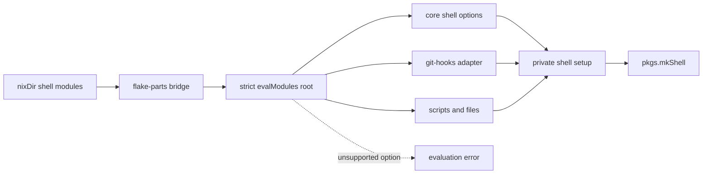

<!-- Voice and structure follow plugins/socrates/voice.md. -->

## Describe

The flake uses devenv modules to define development shells. The project uses
package dependencies, Git hooks, shell setup, scripts, generated files,
language setup, Python environments, and treefmt.

On a machine without the devenv cache, constructing a development shell can
build Rust infrastructure. The build time makes development-shell setup
prohibitive. The project does not use devenv tasks, processes, services,
containers, or deployment features.

## Diagnose

### Hypotheses considered

| Hypothesis | Status | Evidence |
| --- | --- | --- |
| The full devenv CLI causes the build | Rejected | Flake shells use a Bash wrapper in place of the full CLI. |
| Broad module evaluation causes the build | Rejected | Nix laziness avoids most derivations from unused modules. |
| Git hooks require the task runner | Rejected | `git-hooks.nix` provides independent shell integration. |
| Flake integration retains the task runner | Confirmed | The task module and the flake compatibility module reference `devenv-tasks`. |
| A cache miss causes the high cost | Confirmed | The task package evaluates separate Nixpkgs and Rust inputs. |

The visible symptom is a costly development-shell build. The causes are the
unconditional task-runner references in flake integration and the expensive
fallback when the task runner is absent from the cache.

### Diagnosed items

#### Legend

| Prefix | Name | Meaning |
| --- | --- | --- |
| **RC** | Root Cause | A confirmed reason the problem exists. |
| **NC** | Non-Cause | A plausible cause that the evidence rejected. |
| **AC** | Adjacent Constraint | An external rule that every approach must respect. |
| **ID** | Implementation Detail | A practical concern used in the Direction matrix. |

#### RC1 — Flake integration retains task orchestration

Shell entry includes `devenv-tasks` when the project defines no user tasks.
Both the task module and the flake compatibility module retain this dependency.

#### RC2 — The task package has an expensive fallback

A cache miss evaluates a separate package set and builds the Rust task package.
This fallback makes development-shell construction prohibitive.

#### NC1 — Full CLI construction

The flake shell replaces the full devenv CLI with a Bash wrapper.

Implication for Direction: removing the full CLI cannot remove the observed
task-runner cost.

#### NC2 — Git-hook generation

`git-hooks.nix` can generate hook configuration and shell installation without
the devenv task runner.

Implication for Direction: an approach can preserve Git hooks without retaining
task orchestration.

#### AC1 — Required feature boundary

Version 1 requires support for packages, shell configuration, Git hooks,
scripts, and files. A language module is compatible when it uses only these
primitives.

#### AC2 — Excluded feature boundary

Version 1 has no dedicated language, Python, or treefmt adapter. It excludes
tasks, processes, services, profiles, runtime coordination, containers, secret
providers, `devenv up`, and `devenv test`.

## Delimit

Developers cannot construct this project's task-free development shells without
risking an uncached build of the `devenv-tasks` Rust binary. Devenv flake
integration retains this binary and its build-time Nixpkgs and Rust dependencies
when no tasks are configured.

## Direction

### Approaches

#### A1 — Status quo

Keep devenv and depend on its cache. This carries no implementation work and
retains the uncached Rust build risk.

#### A2 — Upstream simple mode

Add a devenv mode that replaces task orchestration with direct shell-entry
actions. This preserves upstream ownership but requires a large upstream change.

#### A3 — Explicit compatibility runner

Build a standalone flake that evaluates a declared devenv option subset and
produces a standard development shell. This keeps delivery local and makes the
compatibility boundary explicit.

### Decision Matrix

| Criterion | A1 — Status quo | A2 — Upstream simple mode | A3 — Compatibility runner |
| --- | --- | --- | --- |
| [[RC1](#rc1)] Removes task orchestration | 🔴 Retains it | 🟢 Removes it in simple mode | 🟢 Omits it |
| [[RC2](#rc2)] Avoids the uncached Rust build | 🔴 Depends on cache availability | 🟢 Removes the dependency | 🟢 Removes the dependency |
| [[AC1](#ac1)] Supports the v1 features | 🟢 Already supported | 🟡 Requires alternate shell-entry paths | 🟢 Implements the declared subset |
| [[AC2](#ac2)] Enforces the excluded boundary | 🔴 Exposes every feature | 🟡 Requires mode-specific validation | 🟢 Rejects unsupported options |
| [ID] Implementation scope | 🟢 No work | 🔴 Large upstream change | 🟡 Medium standalone change |
| [ID] Compatibility maintenance | 🟢 Upstream owns it | 🟢 Upstream owns it after acceptance | 🟡 Tracks the supported option shapes |
| [ID] Delivery control | 🟢 No delivery needed | 🔴 Depends on upstream acceptance | 🟢 Fully controlled and reversible |

### Chosen Approach

> **Chosen: A3 — Explicit compatibility runner.** A standalone flake removes
> both diagnosed causes and enforces the v1 boundary. Contract tests cover
> upstream option drift, shell-entry order, and unsupported options.

The approach assumes each supported option can operate without the task graph.
It can fail through hidden task dependencies, incorrect shell-entry ordering,
or unnoticed upstream option drift. Strict option declarations, private setup
ordering, and adapter-owned compatibility tests control these risks. Modules
that need excluded features will continue to fail evaluation.

### Use Cases

| Actor | Intent | Outcome |
| --- | --- | --- |
| Developer | Declare packages through reusable modules | The packages appear in the shell. |
| Developer | Configure Git hooks | Shell entry installs the configured hooks. |
| Developer | Declare scripts and generated files | The shell exposes scripts and materializes files in a defined order. |
| Module author | Compose supported shell modules | Module merging follows Nix module rules. |
| Module author | Use an unsupported option | Evaluation reports the unsupported option. |
| Developer | Enter a shell without the devenv cache | The shell excludes `devenv-tasks` and its Rust build. |

## Design

### Solution Map

How do discovered modules become a shell while unsupported options stop at the
compatibility boundary?

### Context

The implementation lives in a standalone flake. Its public flake-parts module
keeps the existing devenv namespace, so nixDir can continue discovering shells
and shared modules. Zoo.nix changes the provider behind its `devenv` input name
after the compatibility contract passes. (See [Addendum A.1](#a1).)

The root module declares every supported option. It carries no freeform root
type, so options outside v1 fail through normal Nix module validation. Language
modules receive no separate adapter. They work when their complete option use
fits the v1 primitives.

A private setup hook preserves the ordering v1 needs. File links and Git-hook
configuration become available before hook installation, and all setup runs
before user entry code. Scripts remain ordinary shell packages.

Compatibility tests fetch a pinned devenv source tree inside nix-unit. Devenv
is absent from the production flake inputs and lock graph. Each adapter owns
its upstream fixture and closure checks, so the contract grows with the
implementation. (See [Addendum A.2](#a2).)

### Tasks

| Task | Outcome | Depends on | Priority |
| --- | --- | --- | --- |
| [be44-standalone-foundation](1-be44-standalone-foundation.md) | Provide a standalone flake foundation | — | 0 |
| [887e-strict-shell-modules](2-887e-strict-shell-modules.md) | Evaluate strict shell modules | be44-standalone-foundation | 0 |
| [6f37-declared-files](3-6f37-declared-files.md) | Materialize declared files | 887e-strict-shell-modules | 1 |
| [9157-generated-git-hooks](4-9157-generated-git-hooks.md) | Install generated Git hooks | 887e-strict-shell-modules | 1 |
| [6d31-flake-parts-integration](5-6d31-flake-parts-integration.md) | Expose flake-parts shell integration | 6f37-declared-files, 9157-generated-git-hooks | 0 |
| [c729-zoo-adoption](6-c729-zoo-adoption.md) | Adopt devenv-lite in zoo.nix | 6d31-flake-parts-integration | 0 |

## Technical Addendum

### A.1 — Consumer integration

Zoo.nix imports `inputs.devenv.flakeModule` in `flake.nix` and asks nixDir to
install `mods.nix`. Its only shell definition is `nix/devenvs/default.nix`.
Its only reusable devenv module is `nix/modules/devenv/nix.nix`.
The shell definition currently forces `containers` to an empty set as a
workaround for an upstream process-compose option failure. The lite root does
not declare that namespace, so adoption removes the workaround.

NixDir v3 emits discovered shells into `devenv.shells` and discovered shared
modules into `devenv.modules`. It checks for an input named `devenv`. The
provider can therefore change while those paths and the input name stay stable.

### A.2 — Upstream dependency evidence

Devenv's `src/modules/tasks.nix` selects `devenv-tasks` for flake integration.
Its `src/modules/flake-compat.nix` also embeds that executable in the shell
compatibility wrapper. `src/modules/tasks/package.nix` resolves the package
through devenv's pinned Nixpkgs and Rust overlay.

The evaluated zoo.nix shell derivation references `devenv-tasks-1.10.1`, the
generated task file, the Git-hook tasks, and the flake compatibility wrapper.
Current upstream source was inspected at revision
`eeced8155ca9d573f5f3e22cbe925e7fbe4e761b`.

### A.3 — V1 adapter boundaries

The Git-hook adapter uses the independent `git-hooks.nix` module. Its generated
configuration becomes a managed file before its installation script runs.

The file adapter covers generated text, format-generated content, source paths,
managed symlink replacement, and collision checks. It excludes seed and copy
modes, orphan cleanup, ownership databases, and concurrent entry coordination.
V1 has no task, process, service, container, profile, Python, or treefmt adapter.
